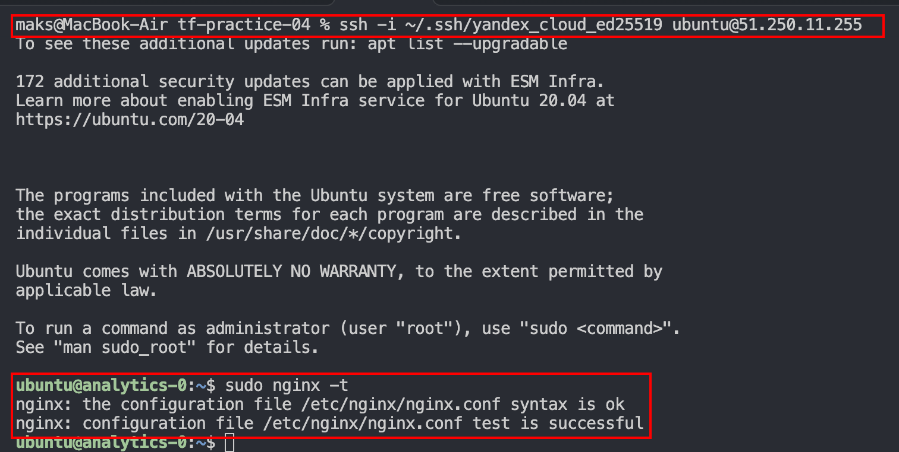
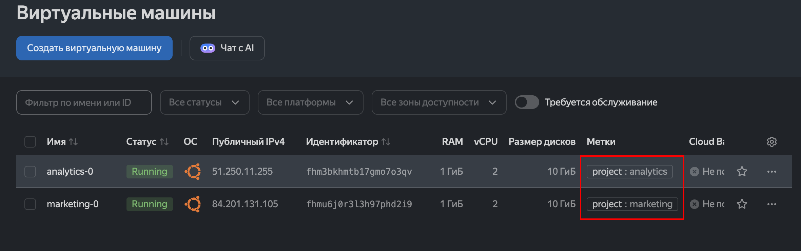

### Задание 1:
Примечание: Для избежания ошибки на MacOs вместо `template_file` использовался `templatefile`

 Вывод `sudo nginx -t` консоли ВМ 

 Метки ВМ в ЛК yandex.cloud

Скриншот содержимого модуля
