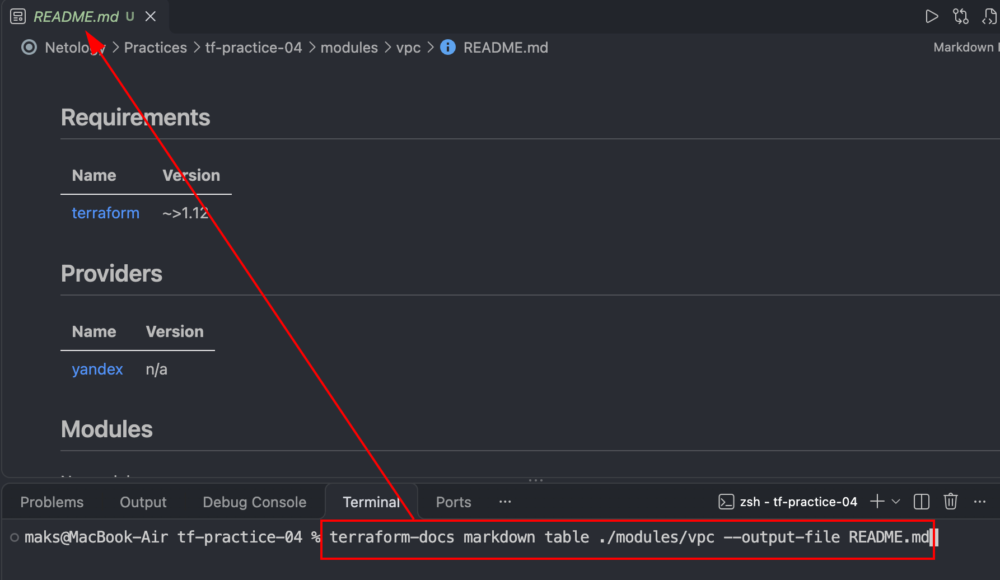
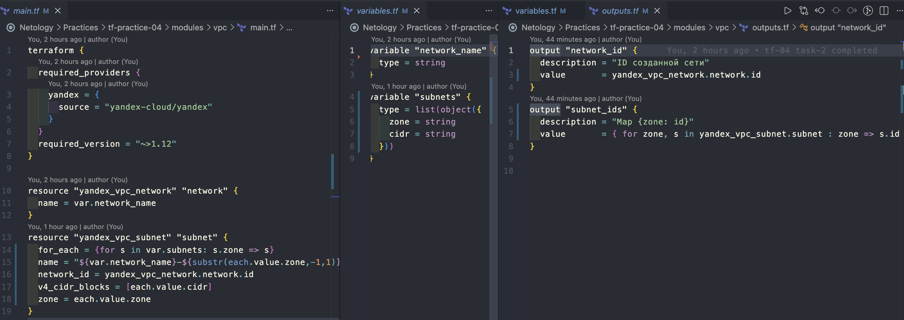
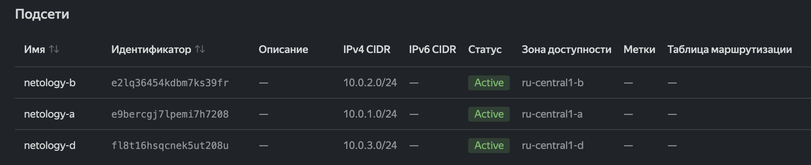

### Задание 1:
----
Примечание: Для избежания ошибки на MacOs вместо `template_file` использовался `templatefile`

 Вывод `sudo nginx -t` консоли ВМ 


 Метки ВМ в ЛК yandex.cloud


Скриншот содержимого модуля


### Задание 2:
----

Локальный модуль vpc


 Вывод в консоли


Документация terraform-docs


### Задание 3:
----
Удаление/импорт модулей прошли успешно, существенных изменений нет.
```
maks@MacBook-Air tf-practice-04 % terraform state list
module.module_vm["analytics"].data.yandex_compute_image.my_image
module.module_vm["analytics"].yandex_compute_instance.vm[0]
module.module_vm["marketing"].data.yandex_compute_image.my_image
module.module_vm["marketing"].yandex_compute_instance.vm[0]
module.vpc_network.yandex_vpc_network.network
module.vpc_network.yandex_vpc_subnet.subnet
maks@MacBook-Air tf-practice-04 % terraform state rm module.vpc_network
Removed module.vpc_network.yandex_vpc_network.network
Removed module.vpc_network.yandex_vpc_subnet.subnet
Successfully removed 2 resource instance(s).
maks@MacBook-Air tf-practice-04 % terraform state rm module.module_vm
Removed module.module_vm["analytics"].data.yandex_compute_image.my_image
Removed module.module_vm["analytics"].yandex_compute_instance.vm[0]
Removed module.module_vm["marketing"].data.yandex_compute_image.my_image
Removed module.module_vm["marketing"].yandex_compute_instance.vm[0]
Successfully removed 4 resource instance(s).
maks@MacBook-Air tf-practice-04 % terraform import module.vpc_network.yandex_vpc_network.network enpj9g9fej459mt9pnc1
module.vpc_network.yandex_vpc_network.network: Importing from ID "enpj9g9fej459mt9pnc1"...
module.module_vm["analytics"].data.yandex_compute_image.my_image: Reading...
module.module_vm["marketing"].data.yandex_compute_image.my_image: Reading...
module.vpc_network.yandex_vpc_network.network: Import prepared!
  Prepared yandex_vpc_network for import
module.vpc_network.yandex_vpc_network.network: Refreshing state... [id=enpj9g9fej459mt9pnc1]
module.module_vm["analytics"].data.yandex_compute_image.my_image: Read complete after 1s [id=fd8vtnn9h4t6esrt91le]
module.module_vm["marketing"].data.yandex_compute_image.my_image: Read complete after 1s [id=fd8vtnn9h4t6esrt91le]

Import successful!

The resources that were imported are shown above. These resources are now in
your Terraform state and will henceforth be managed by Terraform.

maks@MacBook-Air tf-practice-04 % terraform import module.vpc_network.yandex_vpc_subnet.subnet e9be1qvrkqvrs4uigri1
module.module_vm["analytics"].data.yandex_compute_image.my_image: Reading...
module.module_vm["marketing"].data.yandex_compute_image.my_image: Reading...
module.vpc_network.yandex_vpc_subnet.subnet: Importing from ID "e9be1qvrkqvrs4uigri1"...
module.vpc_network.yandex_vpc_subnet.subnet: Import prepared!
  Prepared yandex_vpc_subnet for import
module.vpc_network.yandex_vpc_subnet.subnet: Refreshing state... [id=e9be1qvrkqvrs4uigri1]
module.module_vm["analytics"].data.yandex_compute_image.my_image: Read complete after 1s [id=fd8vtnn9h4t6esrt91le]
module.module_vm["marketing"].data.yandex_compute_image.my_image: Read complete after 1s [id=fd8vtnn9h4t6esrt91le]

Import successful!

The resources that were imported are shown above. These resources are now in
your Terraform state and will henceforth be managed by Terraform.

maks@MacBook-Air tf-practice-04 % terraform import 'module.module_vm["analytics"].yandex_compute_instance.vm[0]' fhmllk2vqkqpbpojbg8i
module.module_vm["analytics"].data.yandex_compute_image.my_image: Reading...
module.module_vm["marketing"].data.yandex_compute_image.my_image: Reading...
module.module_vm["marketing"].data.yandex_compute_image.my_image: Read complete after 0s [id=fd8vtnn9h4t6esrt91le]
module.module_vm["analytics"].data.yandex_compute_image.my_image: Read complete after 0s [id=fd8vtnn9h4t6esrt91le]
module.module_vm["analytics"].yandex_compute_instance.vm[0]: Importing from ID "fhmllk2vqkqpbpojbg8i"...
module.module_vm["analytics"].yandex_compute_instance.vm[0]: Import prepared!
  Prepared yandex_compute_instance for import
module.module_vm["analytics"].yandex_compute_instance.vm[0]: Refreshing state... [id=fhmllk2vqkqpbpojbg8i]

Import successful!

The resources that were imported are shown above. These resources are now in
your Terraform state and will henceforth be managed by Terraform.

maks@MacBook-Air tf-practice-04 % terraform import 'module.module_vm["marketing"].yandex_compute_instance.vm[0]' fhmnj1s2skf1qggfoort
module.module_vm["analytics"].data.yandex_compute_image.my_image: Reading...
module.module_vm["marketing"].data.yandex_compute_image.my_image: Reading...
module.module_vm["marketing"].data.yandex_compute_image.my_image: Read complete after 0s [id=fd8vtnn9h4t6esrt91le]
module.module_vm["analytics"].data.yandex_compute_image.my_image: Read complete after 0s [id=fd8vtnn9h4t6esrt91le]
module.module_vm["marketing"].yandex_compute_instance.vm[0]: Importing from ID "fhmnj1s2skf1qggfoort"...
module.module_vm["marketing"].yandex_compute_instance.vm[0]: Import prepared!
  Prepared yandex_compute_instance for import
module.module_vm["marketing"].yandex_compute_instance.vm[0]: Refreshing state... [id=fhmnj1s2skf1qggfoort]

Import successful!

The resources that were imported are shown above. These resources are now in
your Terraform state and will henceforth be managed by Terraform.

maks@MacBook-Air tf-practice-04 % terraform state list
module.module_vm["analytics"].data.yandex_compute_image.my_image
module.module_vm["analytics"].yandex_compute_instance.vm[0]
module.module_vm["marketing"].data.yandex_compute_image.my_image
module.module_vm["marketing"].yandex_compute_instance.vm[0]
module.vpc_network.yandex_vpc_network.network
module.vpc_network.yandex_vpc_subnet.subnet
maks@MacBook-Air tf-practice-04 % terraform plan
module.module_vm["analytics"].data.yandex_compute_image.my_image: Reading...
module.module_vm["marketing"].data.yandex_compute_image.my_image: Reading...
module.vpc_network.yandex_vpc_network.network: Refreshing state... [id=enpj9g9fej459mt9pnc1]
module.module_vm["marketing"].data.yandex_compute_image.my_image: Read complete after 1s [id=fd8vtnn9h4t6esrt91le]
module.module_vm["analytics"].data.yandex_compute_image.my_image: Read complete after 1s [id=fd8vtnn9h4t6esrt91le]
module.vpc_network.yandex_vpc_subnet.subnet: Refreshing state... [id=e9be1qvrkqvrs4uigri1]
module.module_vm["marketing"].yandex_compute_instance.vm[0]: Refreshing state... [id=fhmnj1s2skf1qggfoort]
module.module_vm["analytics"].yandex_compute_instance.vm[0]: Refreshing state... [id=fhmllk2vqkqpbpojbg8i]

Terraform used the selected providers to generate the following execution plan. Resource actions are indicated with the following symbols:
  ~ update in-place

Terraform will perform the following actions:

  # module.module_vm["analytics"].yandex_compute_instance.vm[0] will be updated in-place
  ~ resource "yandex_compute_instance" "vm" {
      + allow_stopping_for_update = true
        id                        = "fhmllk2vqkqpbpojbg8i"
        name                      = "analytics-0"
        # (16 unchanged attributes hidden)

        # (6 unchanged blocks hidden)
    }

  # module.module_vm["marketing"].yandex_compute_instance.vm[0] will be updated in-place
  ~ resource "yandex_compute_instance" "vm" {
      + allow_stopping_for_update = true
        id                        = "fhmnj1s2skf1qggfoort"
        name                      = "marketing-0"
        # (16 unchanged attributes hidden)

        # (6 unchanged blocks hidden)
    }

Plan: 0 to add, 2 to change, 0 to destroy.

```

### Задание 4:
----

Код модуля


terraform plan


Подсети в ЛК YC
