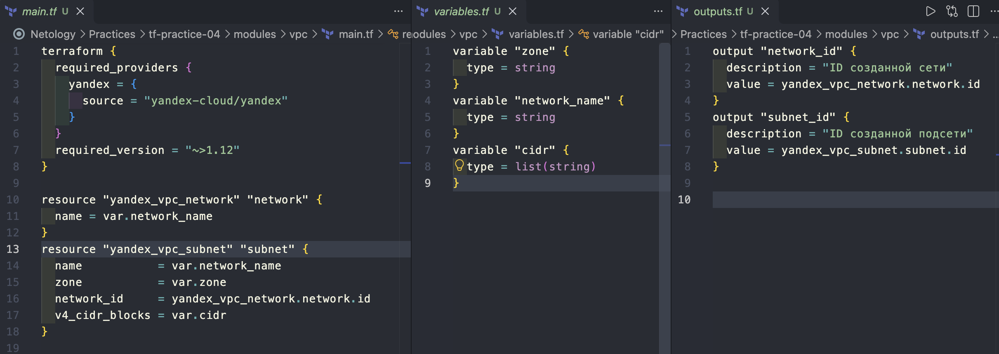

### Задание 1:
----
Примечание: Для избежания ошибки на MacOs вместо `template_file` использовался `templatefile`

 Вывод `sudo nginx -t` консоли ВМ 

 Метки ВМ в ЛК yandex.cloud

Скриншот содержимого модуля

### Задание 2:
----

Локальный модуль vpc

 Вывод в консоли

Документация terraform-docs
