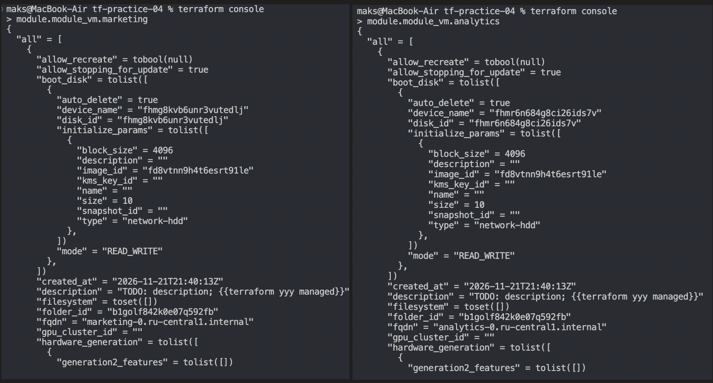
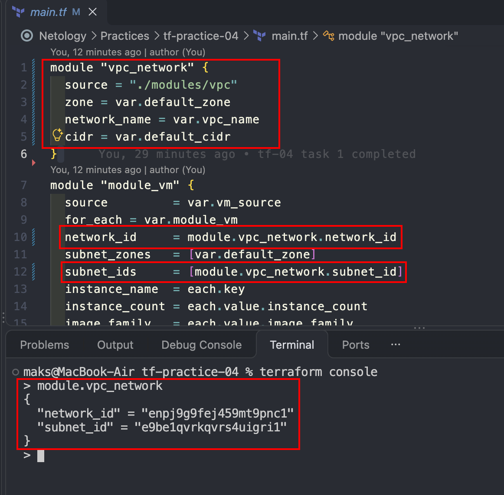
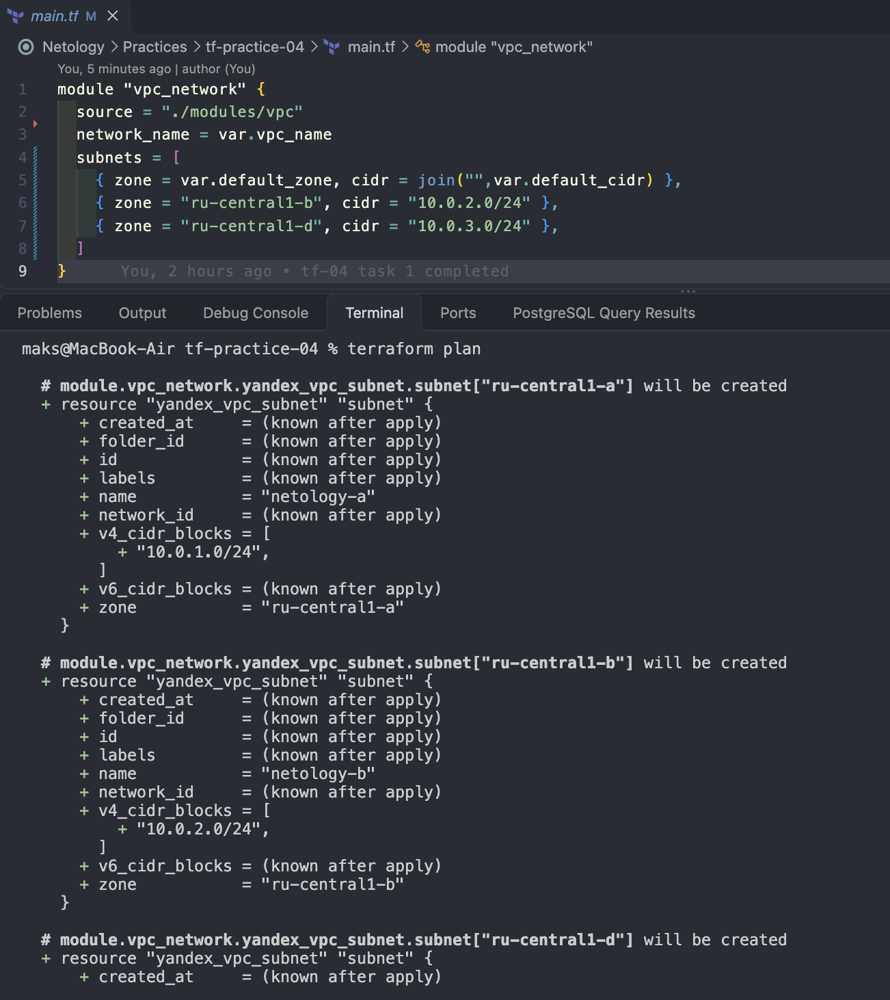

### Задание 1:
----
Примечание: Для избежания ошибки на MacOs вместо `template_file` использовался `templatefile`

 Вывод `sudo nginx -t` консоли ВМ 


 Метки ВМ в ЛК yandex.cloud


Скриншот содержимого модуля


### Задание 2:
----

Локальный модуль vpc


 Вывод в консоли


Документация terraform-docs


### Задание 3:
----
Удаление/импорт модулей прошли успешно, существенных изменений нет.
```
maks@MacBook-Air tf-practice-04 % terraform state list
module.module_vm["analytics"].data.yandex_compute_image.my_image
module.module_vm["analytics"].yandex_compute_instance.vm[0]
module.module_vm["marketing"].data.yandex_compute_image.my_image
module.module_vm["marketing"].yandex_compute_instance.vm[0]
module.vpc_network.yandex_vpc_network.network
module.vpc_network.yandex_vpc_subnet.subnet
maks@MacBook-Air tf-practice-04 % terraform state rm module.vpc_network
Removed module.vpc_network.yandex_vpc_network.network
Removed module.vpc_network.yandex_vpc_subnet.subnet
Successfully removed 2 resource instance(s).
maks@MacBook-Air tf-practice-04 % terraform state rm module.module_vm
Removed module.module_vm["analytics"].data.yandex_compute_image.my_image
Removed module.module_vm["analytics"].yandex_compute_instance.vm[0]
Removed module.module_vm["marketing"].data.yandex_compute_image.my_image
Removed module.module_vm["marketing"].yandex_compute_instance.vm[0]
Successfully removed 4 resource instance(s).
maks@MacBook-Air tf-practice-04 % terraform import module.vpc_network.yandex_vpc_network.network enpj9g9fej459mt9pnc1
module.vpc_network.yandex_vpc_network.network: Importing from ID "enpj9g9fej459mt9pnc1"...
module.module_vm["analytics"].data.yandex_compute_image.my_image: Reading...
module.module_vm["marketing"].data.yandex_compute_image.my_image: Reading...
module.vpc_network.yandex_vpc_network.network: Import prepared!
  Prepared yandex_vpc_network for import
module.vpc_network.yandex_vpc_network.network: Refreshing state... [id=enpj9g9fej459mt9pnc1]
module.module_vm["analytics"].data.yandex_compute_image.my_image: Read complete after 1s [id=fd8vtnn9h4t6esrt91le]
module.module_vm["marketing"].data.yandex_compute_image.my_image: Read complete after 1s [id=fd8vtnn9h4t6esrt91le]

Import successful!

The resources that were imported are shown above. These resources are now in
your Terraform state and will henceforth be managed by Terraform.

maks@MacBook-Air tf-practice-04 % terraform import module.vpc_network.yandex_vpc_subnet.subnet e9be1qvrkqvrs4uigri1
module.module_vm["analytics"].data.yandex_compute_image.my_image: Reading...
module.module_vm["marketing"].data.yandex_compute_image.my_image: Reading...
module.vpc_network.yandex_vpc_subnet.subnet: Importing from ID "e9be1qvrkqvrs4uigri1"...
module.vpc_network.yandex_vpc_subnet.subnet: Import prepared!
  Prepared yandex_vpc_subnet for import
module.vpc_network.yandex_vpc_subnet.subnet: Refreshing state... [id=e9be1qvrkqvrs4uigri1]
module.module_vm["analytics"].data.yandex_compute_image.my_image: Read complete after 1s [id=fd8vtnn9h4t6esrt91le]
module.module_vm["marketing"].data.yandex_compute_image.my_image: Read complete after 1s [id=fd8vtnn9h4t6esrt91le]

Import successful!

The resources that were imported are shown above. These resources are now in
your Terraform state and will henceforth be managed by Terraform.

maks@MacBook-Air tf-practice-04 % terraform import 'module.module_vm["analytics"].yandex_compute_instance.vm[0]' fhmllk2vqkqpbpojbg8i
module.module_vm["analytics"].data.yandex_compute_image.my_image: Reading...
module.module_vm["marketing"].data.yandex_compute_image.my_image: Reading...
module.module_vm["marketing"].data.yandex_compute_image.my_image: Read complete after 0s [id=fd8vtnn9h4t6esrt91le]
module.module_vm["analytics"].data.yandex_compute_image.my_image: Read complete after 0s [id=fd8vtnn9h4t6esrt91le]
module.module_vm["analytics"].yandex_compute_instance.vm[0]: Importing from ID "fhmllk2vqkqpbpojbg8i"...
module.module_vm["analytics"].yandex_compute_instance.vm[0]: Import prepared!
  Prepared yandex_compute_instance for import
module.module_vm["analytics"].yandex_compute_instance.vm[0]: Refreshing state... [id=fhmllk2vqkqpbpojbg8i]

Import successful!

The resources that were imported are shown above. These resources are now in
your Terraform state and will henceforth be managed by Terraform.

maks@MacBook-Air tf-practice-04 % terraform import 'module.module_vm["marketing"].yandex_compute_instance.vm[0]' fhmnj1s2skf1qggfoort
module.module_vm["analytics"].data.yandex_compute_image.my_image: Reading...
module.module_vm["marketing"].data.yandex_compute_image.my_image: Reading...
module.module_vm["marketing"].data.yandex_compute_image.my_image: Read complete after 0s [id=fd8vtnn9h4t6esrt91le]
module.module_vm["analytics"].data.yandex_compute_image.my_image: Read complete after 0s [id=fd8vtnn9h4t6esrt91le]
module.module_vm["marketing"].yandex_compute_instance.vm[0]: Importing from ID "fhmnj1s2skf1qggfoort"...
module.module_vm["marketing"].yandex_compute_instance.vm[0]: Import prepared!
  Prepared yandex_compute_instance for import
module.module_vm["marketing"].yandex_compute_instance.vm[0]: Refreshing state... [id=fhmnj1s2skf1qggfoort]

Import successful!

The resources that were imported are shown above. These resources are now in
your Terraform state and will henceforth be managed by Terraform.

maks@MacBook-Air tf-practice-04 % terraform state list
module.module_vm["analytics"].data.yandex_compute_image.my_image
module.module_vm["analytics"].yandex_compute_instance.vm[0]
module.module_vm["marketing"].data.yandex_compute_image.my_image
module.module_vm["marketing"].yandex_compute_instance.vm[0]
module.vpc_network.yandex_vpc_network.network
module.vpc_network.yandex_vpc_subnet.subnet
maks@MacBook-Air tf-practice-04 % terraform plan
module.module_vm["analytics"].data.yandex_compute_image.my_image: Reading...
module.module_vm["marketing"].data.yandex_compute_image.my_image: Reading...
module.vpc_network.yandex_vpc_network.network: Refreshing state... [id=enpj9g9fej459mt9pnc1]
module.module_vm["marketing"].data.yandex_compute_image.my_image: Read complete after 1s [id=fd8vtnn9h4t6esrt91le]
module.module_vm["analytics"].data.yandex_compute_image.my_image: Read complete after 1s [id=fd8vtnn9h4t6esrt91le]
module.vpc_network.yandex_vpc_subnet.subnet: Refreshing state... [id=e9be1qvrkqvrs4uigri1]
module.module_vm["marketing"].yandex_compute_instance.vm[0]: Refreshing state... [id=fhmnj1s2skf1qggfoort]
module.module_vm["analytics"].yandex_compute_instance.vm[0]: Refreshing state... [id=fhmllk2vqkqpbpojbg8i]

Terraform used the selected providers to generate the following execution plan. Resource actions are indicated with the following symbols:
  ~ update in-place

Terraform will perform the following actions:

  # module.module_vm["analytics"].yandex_compute_instance.vm[0] will be updated in-place
  ~ resource "yandex_compute_instance" "vm" {
      + allow_stopping_for_update = true
        id                        = "fhmllk2vqkqpbpojbg8i"
        name                      = "analytics-0"
        # (16 unchanged attributes hidden)

        # (6 unchanged blocks hidden)
    }

  # module.module_vm["marketing"].yandex_compute_instance.vm[0] will be updated in-place
  ~ resource "yandex_compute_instance" "vm" {
      + allow_stopping_for_update = true
        id                        = "fhmnj1s2skf1qggfoort"
        name                      = "marketing-0"
        # (16 unchanged attributes hidden)

        # (6 unchanged blocks hidden)
    }

Plan: 0 to add, 2 to change, 0 to destroy.

```

### Задание 4:
----

Код модуля


terraform plan


Подсети в ЛК YC


### Задание 5:

terraform plan `HA = false`
```
maks@MacBook-Air tf-practice-04 % terraform plan

Terraform used the selected providers to generate the following execution plan. Resource actions are indicated with the
following symbols:
  + create
 <= read (data resources)

Terraform will perform the following actions:

  # module.cluster_mysql.data.yandex_vpc_network.netology will be read during apply
  # (config refers to values not yet known)
 <= data "yandex_vpc_network" "netology" {
      + created_at                = (known after apply)
      + default_security_group_id = (known after apply)
      + description               = (known after apply)
      + folder_id                 = (known after apply)
      + id                        = (known after apply)
      + labels                    = (known after apply)
      + name                      = (known after apply)
      + network_id                = (known after apply)
      + subnet_ids                = (known after apply)
    }

  # module.cluster_mysql.data.yandex_vpc_subnet.netology[0] will be read during apply
  # (config refers to values not yet known)
 <= data "yandex_vpc_subnet" "netology" {
      + created_at     = (known after apply)
      + description    = (known after apply)
      + dhcp_options   = (known after apply)
      + folder_id      = (known after apply)
      + id             = (known after apply)
      + labels         = (known after apply)
      + name           = (known after apply)
      + network_id     = (known after apply)
      + route_table_id = (known after apply)
      + subnet_id      = (known after apply)
      + v4_cidr_blocks = (known after apply)
      + v6_cidr_blocks = (known after apply)
      + zone           = (known after apply)
    }

  # module.cluster_mysql.yandex_mdb_mysql_cluster.my_cluster will be created
  + resource "yandex_mdb_mysql_cluster" "my_cluster" {
      + allow_regeneration_host   = false
      + backup_retain_period_days = (known after apply)
      + created_at                = (known after apply)
      + deletion_protection       = (known after apply)
      + disk_encryption_key_id    = (known after apply)
      + environment               = "PRESTABLE"
      + folder_id                 = (known after apply)
      + health                    = (known after apply)
      + host_group_ids            = (known after apply)
      + id                        = (known after apply)
      + mysql_config              = (known after apply)
      + name                      = "my_cluster_1"
      + network_id                = (known after apply)
      + status                    = (known after apply)
      + version                   = "8.0"

      + access (known after apply)

      + backup_window_start (known after apply)

      + connection_manager (known after apply)

      + disk_size_autoscaling (known after apply)

      + host {
          + assign_public_ip   = false
          + fqdn               = (known after apply)
          + replication_source = (known after apply)
          + subnet_id          = (known after apply)
          + zone               = (known after apply)
        }

      + maintenance_window (known after apply)

      + performance_diagnostics (known after apply)

      + resources {
          + disk_size          = 20
          + disk_type_id       = "network-ssd"
          + resource_preset_id = "s2.micro"
        }
    }

  # module.db_user.random_password.user_passsword will be created
  + resource "random_password" "user_passsword" {
      + bcrypt_hash = (sensitive value)
      + id          = (known after apply)
      + length      = 16
      + lower       = true
      + min_lower   = 0
      + min_numeric = 0
      + min_special = 0
      + min_upper   = 0
      + number      = true
      + numeric     = true
      + result      = (sensitive value)
      + special     = false
      + upper       = true
    }

  # module.db_user.yandex_mdb_mysql_database.app_db will be created
  + resource "yandex_mdb_mysql_database" "app_db" {
      + cluster_id = (known after apply)
      + id         = (known after apply)
      + name       = "my_db"
    }

  # module.db_user.yandex_mdb_mysql_user.app_user will be created
  + resource "yandex_mdb_mysql_user" "app_user" {
      + authentication_plugin = (known after apply)
      + cluster_id            = (known after apply)
      + connection_manager    = (known after apply)
      + generate_password     = false
      + id                    = (known after apply)
      + name                  = "mmr-user"
      + password              = (sensitive value)
      + password_wo           = (write-only attribute)

      + connection_limits (known after apply)

      + permission {
          + database_name = "my_db"
          + roles         = [
              + "ALL",
            ]
        }

      + user_connection_manager (known after apply)
    }

  # module.vpc_network.yandex_vpc_network.network will be created
  + resource "yandex_vpc_network" "network" {
      + created_at                = (known after apply)
      + default_security_group_id = (known after apply)
      + folder_id                 = (known after apply)
      + id                        = (known after apply)
      + labels                    = (known after apply)
      + name                      = "netology"
      + subnet_ids                = (known after apply)
    }

  # module.vpc_network.yandex_vpc_subnet.subnet["ru-central1-a"] will be created
  + resource "yandex_vpc_subnet" "subnet" {
      + created_at     = (known after apply)
      + folder_id      = (known after apply)
      + id             = (known after apply)
      + labels         = (known after apply)
      + name           = "netology-a"
      + network_id     = (known after apply)
      + v4_cidr_blocks = [
          + "10.0.1.0/24",
        ]
      + v6_cidr_blocks = (known after apply)
      + zone           = "ru-central1-a"
    }

  # module.vpc_network.yandex_vpc_subnet.subnet["ru-central1-d"] will be created
  + resource "yandex_vpc_subnet" "subnet" {
      + created_at     = (known after apply)
      + folder_id      = (known after apply)
      + id             = (known after apply)
      + labels         = (known after apply)
      + name           = "netology-d"
      + network_id     = (known after apply)
      + v4_cidr_blocks = [
          + "10.0.3.0/24",
        ]
      + v6_cidr_blocks = (known after apply)
      + zone           = "ru-central1-d"
    }

  # module.vpc_network.yandex_vpc_subnet.subnet["ru-central1-e"] will be created
  + resource "yandex_vpc_subnet" "subnet" {
      + created_at     = (known after apply)
      + folder_id      = (known after apply)
      + id             = (known after apply)
      + labels         = (known after apply)
      + name           = "netology-e"
      + network_id     = (known after apply)
      + v4_cidr_blocks = [
          + "10.0.2.0/24",
        ]
      + v6_cidr_blocks = (known after apply)
      + zone           = "ru-central1-e"
    }

Plan: 8 to add, 0 to change, 0 to destroy.
```

terraform plan `HA = true` после создания кластера
```

Terraform will perform the following actions:

  # module.cluster_mysql.yandex_mdb_mysql_cluster.my_cluster will be updated in-place
  ~ resource "yandex_mdb_mysql_cluster" "my_cluster" {
        id                        = "c9q3ldcnmhb16qqe2l2t"
        name                      = "my_cluster_1"
        # (15 unchanged attributes hidden)

      + host {
          + assign_public_ip = false
          + subnet_id        = "e9bgmpjup0lr1orsjphm"
          + zone             = "ru-central1-a"
        }

        # (8 unchanged blocks hidden)
    }

Plan: 0 to add, 1 to change, 0 to destroy.
```